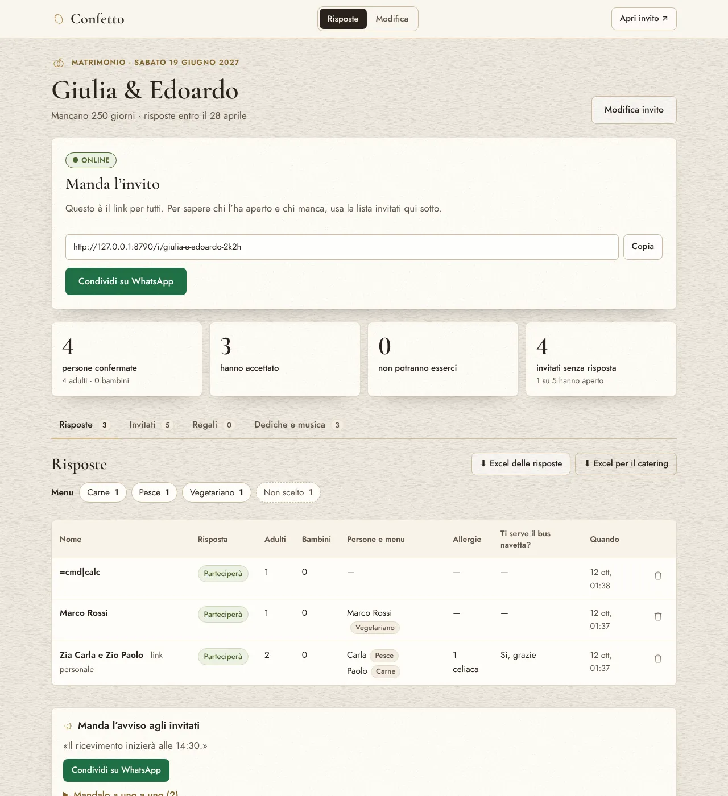
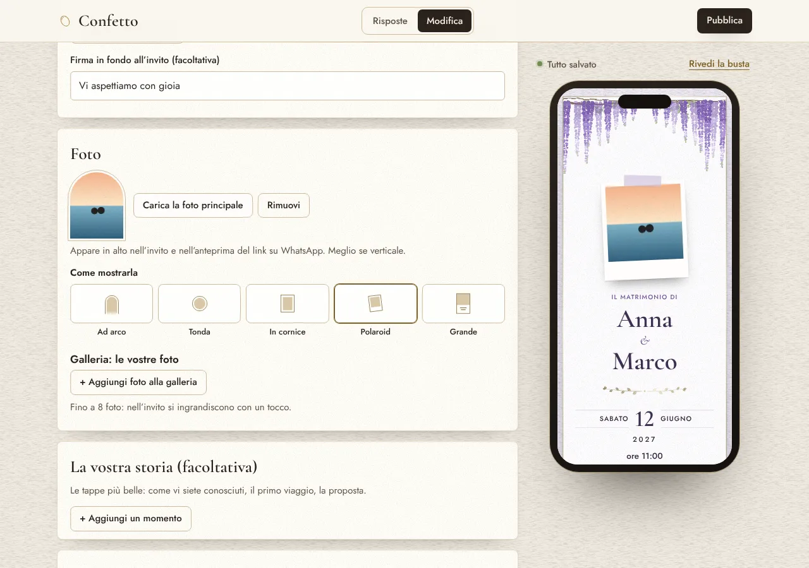
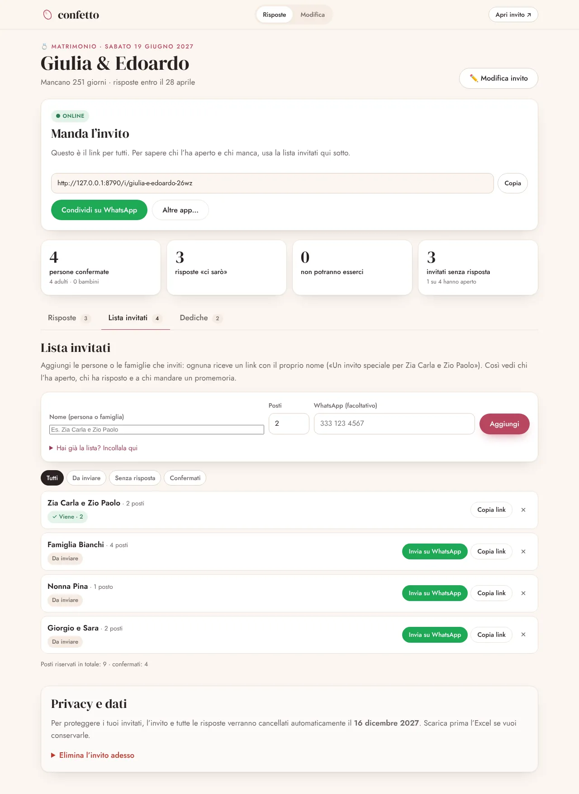
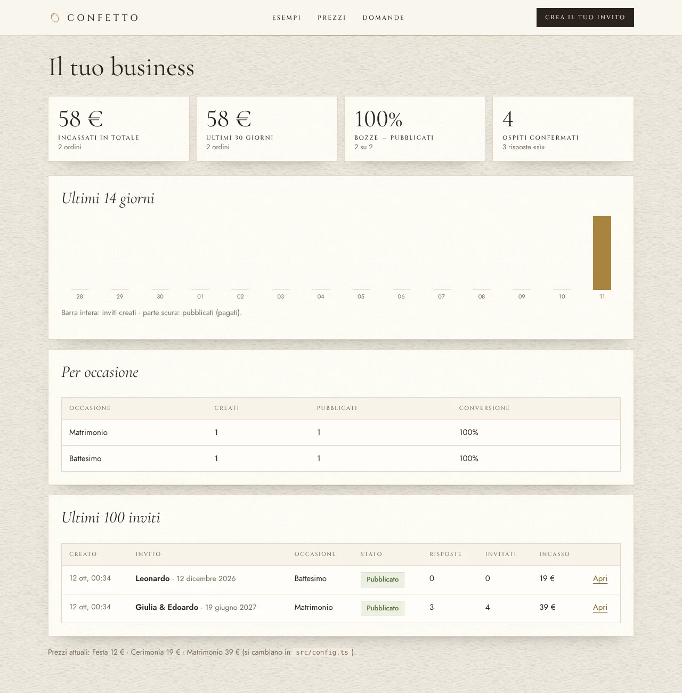

# 🍬 Confetto: inviti digitali con conferme di presenza

**Confetto** è un servizio online per creare in 5 minuti un invito digitale elegante per matrimoni, battesimi, comunioni, cresime, lauree, 18 anni e feste. L'invito si manda su WhatsApp e le conferme di presenza arrivano da sole, in una lista sempre aggiornata. Il cliente crea e prova l'invito gratis e paga **una volta sola**, da 12 € a 39 €, quando lo pubblica.

Il prodotto è completo e testato: sito, editor, invito animato, dashboard, pagamenti con Stripe, email, pulizia automatica dei dati e area admin per te. Per incassare ti mancano solo il dominio e gli account (sezione 4).


---

## In breve

| | |
|---|---|
| **Cosa vendi** | Inviti digitali interattivi con raccolta automatica delle conferme (RSVP) |
| **A chi** | Sposi, genitori (battesimi, comunioni, cresime), neolaureati, diciottenni, chiunque organizzi una festa |
| **Come guadagni** | Pagamento unico per invito: 12 € (feste), 19 € (cerimonie), 39 € (matrimoni) |
| **Margine** | ~95%: l'hosting costa 0–5 $ al mese, Stripe trattiene circa 1,5% + 0,25 € per pagamento |
| **Obiettivo "il giusto"** | 3 inviti al giorno ≈ **2.200 € al mese** di incasso |
| **Lavoro richiesto** | Niente magazzino né spedizioni, nessun servizio da erogare a mano. Il tuo tempo va nel marketing. |

> **Versione di prova da far vedere a tutti:** [Confetto Studio](https://claude.ai/artifact/YLJQyivx9o7tEuhcGyDcBj). Scegli qualsiasi occasione, personalizzi l'invito con l'anteprima dal vivo e ottieni un link da mandare su WhatsApp. Gira tutta nel browser: la risposta degli invitati arriva su WhatsApp a chi organizza, invece che nella dashboard. Sorgenti in `demo/studio/`, si rigenera con `npm run demo:studio`.

---

## 1. L'idea, e perché funziona già altrove

**Il problema.** In Italia oggi un invito si fa in due modi. La carta costa 2–5 € a invito, cioè 250–500 € per 100 invitati. L'alternativa è un'immagine fatta con Canva e mandata su WhatsApp. In entrambi i casi le conferme sono un incubo: messaggi sparsi nei gruppi di famiglia, telefonate, fogli Excel per contare adulti, bambini, celiaci e vegetariani da comunicare al ristorante.

**Dove funziona già:**

- **Stati Uniti.** [Partiful](https://partiful.com), l'app per inviti con RSVP via link, ha vinto il premio **"Best App 2024" di Google Play** ([blog di Google](https://blog.google/products/google-play/google-play-best-apps-games-2024/)). Paperless Post, Evite e Greenvelope vendono inviti digitali da oltre dieci anni.
- **America Latina e Spagna.** Le *invitaciones digitales* sono diventate un mestiere: migliaia di persone vendono inviti web interattivi per matrimoni e "quince años" su Etsy e Mercado Libre ([esempio](https://listado.mercadolibre.com.ar/invitaciones-digitales-15anos)).
- **Italia, oggi.** Su Matrimonio.com ci sono fornitori che fanno inviti digitali con RSVP **a mano**, a circa **35–45 €**, consegnati **in 24–72 ore** ([esempio](https://www.matrimonio.com/partecipazioni-nozze/creations-digital-wedding--e430665)). Per battesimi e comunioni si trovano quasi solo immagini statiche (Canva e app simili), senza gestione delle conferme ([Aranzulla](https://www.aranzulla.it/app-per-creare-inviti-comunione-1483386.html)).

**Il nostro spazio.** Copiamo un modello già provato e lo facciamo meglio per l'Italia:

- **Self-service e immediato**: pronto in 5 minuti, non in 72 ore, e a un prezzo pari o inferiore.
- **Pensato per le cerimonie italiane**: Battesimo, Prima Comunione, Cresima, Laurea con corona d'alloro, 18 anni, confettata, IBAN per la busta, menu per celiaci.
- **WhatsApp prima di tutto**: ogni invitato può ricevere un **link personale** («Un invito speciale per Zia Carla e Zio Paolo»). Vedi chi l'ha aperto e mandi il promemoria con un tocco solo a chi non ha risposto.

**Il mercato.** Nel 2024 in Italia si sono celebrati **173.272 matrimoni** ([ISTAT](https://www.istat.it/comunicato-stampa/matrimoni-unioni-civili-separazioni-e-divorzi-anno-2024/)). Si aggiungono battesimi, comunioni, cresime, lauree e diciottesimi: centinaia di migliaia di feste all'anno, ognuna con il suo invito. Per arrivare a "il giusto" basta servirne una frazione minuscola.

**Il motore di crescita gratis.** Ogni invito venduto viene aperto da 50–150 persone e in fondo c'è scritto «Creato con Confetto · crea anche tu il tuo invito». Ogni cliente porta potenziali clienti: chi riceve un invito di matrimonio, prima o poi, organizza un battesimo.

---

## 2. Come fa soldi

**Prezzi** (pagamento unico, si cambiano in `src/config.ts`):

| Occasione | Prezzo |
|---|---|
| Compleanno, baby shower, festa | **12 €** |
| Battesimo, Comunione, Cresima, Laurea, 18 anni, anniversario | **19 €** |
| Matrimonio | **39 €** |

Il cliente crea l'invito, lo vede completo e lo personalizza gratis. Finché non paga, l'invito mostra la scritta «Anteprima» e non raccoglie conferme. Il pagamento sblocca tutto. Su Stripe puoi creare **codici sconto** (es. `LANCIO30`) e la pagina di pagamento li accetta già.

**Quanto puoi incassare.** Il prezzo medio stimato è circa 24,60 €, con un mix di 35% matrimoni, 45% cerimonie e 20% feste. Stripe trattiene circa 0,62 € a vendita.

| Ritmo | Vendite al mese | Incasso lordo al mese | Dopo le commissioni Stripe |
|---|---|---|---|
| 1 al giorno | ~30 | ~740 € | ~720 € |
| **3 al giorno** | **~90** | **~2.200 €** | **~2.150 €** |
| 6 al giorno | ~180 | ~4.400 € | ~4.300 € |

*Le cifre sono prima delle tasse. La stagionalità conta: gli inviti di matrimonio si mandano soprattutto tra gennaio e giugno, comunioni e cresime tra marzo e maggio, compleanni e lauree tutto l'anno.*

**Entrate extra, senza scrivere codice:**

- **Servizio "lo faccio io per te"** a 49–79 €, venduto su Etsy, Instagram e Matrimonio.com. Crei l'invito al posto del cliente con lo stesso strumento, in 10 minuti. È anche il modo più veloce per fare le prime vendite (vedi [docs/MARKETING.md](docs/MARKETING.md)).
- **Partner** come wedding planner, fotografi, pasticcerie (confettate) e location: un codice sconto personale per i loro clienti e una commissione per loro.

---

## 3. Cosa c'è già (tutto funzionante)

**Per gli invitati** (nessuna app, si apre da WhatsApp):

- busta animata con sigillo di ceralacca e iniziali, poi una pioggia di coriandoli
- saluto personalizzato con il nome dell'invitato
- foto, conto alla rovescia, messaggio, programma con il tasto «Come arrivare» (Google Maps)
- dress code, lista nozze, IBAN con il tasto «Copia»
- conferma di presenza: «Parteciperò con piacere» / «Non potrò partecipare», adulti, bambini, allergie e menu, una domanda personalizzata (es. «Ti serve la navetta?») e un messaggio per gli sposi
- risposta modificabile in qualsiasi momento
- «Aggiungi al calendario» per iPhone, Android e Google Calendar
- anteprima bella del link su WhatsApp, con foto oppure con l'immagine della busta

**Per chi organizza:**

- editor con anteprima dal vivo e salvataggio automatico
- 9 stili da cartoleria di lusso (carta di cotone, oro a caldo, acquerelli, sigillo in ceralacca): Avorio e oro, Ulivo, Amalfi, Mezzanotte, Alloro, Cielo, Cipria, Grano, Gala
- frasi già pronte per ogni occasione, foto ridimensionata automaticamente
- dashboard: persone confermate, adulti e bambini, chi non viene, dediche
- **lista invitati con link personali**, anche incollando l'elenco intero: «Invia su WhatsApp», stato «aperto / non aperto / ha risposto», **promemoria** solo a chi manca
- **Excel (CSV)** per ristorante, catering e tableau, con chi non ha ancora risposto in fondo
- email con il link di gestione, avviso a ogni nuova risposta, recupero dei link dimenticati
- eliminazione dell'invito in qualsiasi momento

**Per te (il business):**

- pagamenti **Stripe Checkout** (carte, Apple Pay, Google Pay e codici sconto), con conferma sia dal ritorno del browser sia dal webhook
- **area `/admin`** protetta da password: incasso totale e degli ultimi 30 giorni, conversione da bozza a pagato, grafico degli ultimi 14 giorni, ultimi 100 inviti
- **pagine SEO** per ogni occasione (`/inviti/battesimo`…) e raccolte di **frasi** (`/frasi/matrimonio`…) per farti trovare su Google
- privacy: dati cancellati in automatico 6 mesi dopo l'evento e bozze abbandonate dopo 60 giorni; font ospitati in casa (niente Google Fonts); nessun cookie di profilazione
- sicurezza: link di gestione segreti e impossibili da indovinare, protezione anti-spam, Content-Security-Policy, CSV protetto dalle formule Excel
- statistiche visite facoltative e senza cookie (Cloudflare Web Analytics)

| Dashboard | Editor |
|---|---|
|  |  |
| **Lista invitati con link personali** | **La tua area admin** |
|  |  |


---

## 4. Mettilo online (circa 30–60 minuti)

Ti servono questi account, tutti gratuiti per iniziare:

1. **Cloudflare** ([dash.cloudflare.com](https://dash.cloudflare.com)): ospita sito, database e foto. Per attivare R2 (le foto) devi aggiungere un metodo di pagamento, ma il piano gratuito è ampio (10 GB).
2. **Stripe** ([stripe.com](https://stripe.com)): incassa i pagamenti. Per i pagamenti veri serve la verifica dei tuoi dati e del conto.
3. **Resend** ([resend.com](https://resend.com)), facoltativo: invia le email (3.000 al mese gratis).
4. **Un dominio**, ad esempio `confetto.it` o simile (circa 10–15 € l'anno).

Poi, dal computer (serve [Node.js](https://nodejs.org) 20 o superiore):

```bash
git clone <questo-repo> confetto && cd confetto
npm install
npx wrangler login                          # collega Cloudflare

npx wrangler d1 create confetto             # copia il "database_id" che stampa dentro wrangler.toml
npx wrangler r2 bucket create confetto-media
npm run db:migrate:remote                   # crea le tabelle

npx wrangler secret put STRIPE_SECRET_KEY      # sk_test_... per provare, poi sk_live_...
npx wrangler secret put ADMIN_PASSWORD         # la password della tua area /admin
npx wrangler secret put RESEND_API_KEY         # facoltativo

npm run deploy                              # ti dà un indirizzo *.workers.dev funzionante
```

**Collega Stripe (webhook).** In Stripe vai su *Sviluppatori → Webhook → Aggiungi endpoint*. Come URL usa `https://TUO-DOMINIO/api/stripe/webhook`, come eventi `checkout.session.completed` e `checkout.session.async_payment_succeeded`. Copia il "Signing secret" e poi:

```bash
npx wrangler secret put STRIPE_WEBHOOK_SECRET   # whsec_...
```

**Il tuo dominio.** In Cloudflare vai su *Workers & Pages → confetto → Impostazioni → Domini e route → Aggiungi dominio personalizzato*. Poi in `wrangler.toml` imposta `PUBLIC_URL = "https://tuodominio.it"` ed `EMAIL_FROM = "Confetto <ciao@tuodominio.it>"`. In Resend verifica il dominio aggiungendo i record DNS che ti indica. Infine `npm run deploy`.

**Prova tutto prima di incassare.** Con le chiavi di test (`sk_test_...`):

1. crea un invito
2. pubblicalo pagando con la carta di prova `4242 4242 4242 4242` (qualsiasi data futura e qualsiasi CVC)
3. rispondi da un altro telefono
4. controlla la dashboard e `/admin` (utente `admin`)

Quando tutto funziona, sostituisci la chiave con `sk_live_...` e crea il webhook anche in modalità live.

**Prima di aprire al pubblico:**

- [ ] in `src/config.ts` metti i tuoi dati in `BRAND` (nome legale, P.IVA, indirizzo, email di assistenza): compaiono in privacy, termini ed email
- [ ] fai rivedere le pagine `/privacy` e `/termini`, che sono modelli: a un professionista, oppure usa iubenda
- [ ] verifica che il nome "Confetto" sia libero come marchio e dominio, altrimenti cambialo in `BRAND.name`
- [ ] (facoltativo) attiva Cloudflare Web Analytics e incolla il token in `CF_ANALYTICS_TOKEN`
- [ ] fai un acquisto vero da 12 € e rimborsalo da Stripe

> Puoi anche chiedere a Claude Code di fare questi passaggi con te: gli bastano gli accessi.
> In `.github/workflows/deploy.yml` c'è un'azione per pubblicare con un clic da GitHub, dopo aver aggiunto i secret `CLOUDFLARE_API_TOKEN` e `CLOUDFLARE_ACCOUNT_ID`.

---

## 5. Trovare i primi 100 clienti

Il prodotto non si vende da solo il primo giorno, ma ogni invito venduto ne porta altri. Il piano, in ordine di velocità:

1. **Etsy e Instagram con il servizio "fatto per te"** (49–79 €): la domanda esiste già e incassi dalla prima settimana. Ogni invito porta il footer verso il sito.
2. **Gruppi Facebook "Spose 2026/2027"**: hanno decine di migliaia di iscritte. Non fare spam: offri di creare gratis l'invito alle prime 10 in cambio di un parere.
3. **Video brevi** su TikTok, Reels e Shorts: lo schermo del telefono con la busta che si apre. È il contenuto che ha fatto crescere le *invitaciones digitales*.
4. **Partner locali**: wedding planner, fotografi, pasticcerie per la confettata, parrocchie, catechisti per le comunioni, ludoteche per i compleanni. Dai a ciascuno un codice sconto.
5. **Google**: le pagine `/inviti/...` e `/frasi/...` sono già scritte per ricerche come «frasi invito battesimo». Aggiungi un articolo a settimana.
6. **Google Ads** con 5–10 € al giorno su ricerche ad alta intenzione («invito digitale matrimonio», «partecipazioni digitali»), solo dopo aver visto che chi arriva compra.

Testi pronti da copiare (post, messaggi ai partner, scheda Etsy, parole chiave) sono in **[docs/MARKETING.md](docs/MARKETING.md)**.

**Numeri da guardare ogni settimana** (li trovi in `/admin`): inviti creati, percentuale di bozze pagate (punta al 15–25%), occasioni che convertono di più e incasso degli ultimi 30 giorni.

---

## 6. Burocrazia in breve (non è consulenza legale o fiscale)

- **Partita IVA**: per vendere in modo continuativo serve. Il **regime forfettario** è il più semplice. Fatti consigliare il codice ATECO da un commercialista: di solito si usano quelli per servizi web e portali.
- **Vendite online a privati**: non serve lo scontrino, ma gli incassi vanno registrati; la fattura si emette se il cliente la chiede. Stripe ti dà l'elenco di tutti i pagamenti.
- **Privacy**: chi organizza la festa è titolare dei dati dei suoi invitati e tu sei "responsabile del trattamento". Il modello di informativa c'è già, ma va completato e verificato. I fornitori (Cloudflare, Stripe, Resend) offrono già i loro accordi di trattamento dati (DPA).
- **Diritto di recesso**: prima di pagare il cliente spunta la richiesta di attivazione immediata (art. 59 Codice del Consumo, contenuto digitale). Il modulo c'è già.

## 7. Costi per tenerlo acceso

| Voce | Costo |
|---|---|
| Cloudflare Workers, D1 e R2 | 0 € con il piano gratuito; 5 $ al mese con il piano a pagamento, consigliato quando cresci |
| Dominio | ~10–15 € all'anno |
| Stripe | ~1,5% + 0,25 € per pagamento con carte europee, nessun canone |
| Resend (email) | 0 € fino a 3.000 email al mese |
| Privacy e termini (es. iubenda) | ~30–100 € all'anno, facoltativo |
| Commercialista e contributi | dipende dalla tua situazione |

## 8. Idee per guadagnare di più (prossimi passi)

- **Versione in inglese per i matrimoni di stranieri in Italia** (destination wedding): budget molto più alti, prezzo 59–79 €.
- **Album foto degli invitati** dopo la festa: un QR sui tavoli, gli ospiti caricano le foto senza app, come l'americana POV. Si venderebbe come extra da 19 €.
- **QR stampabile** per save-the-date e tableau di carta che rimanda all'invito.
- **Rimozione del footer** «Creato con Confetto» come extra a pagamento.
- **Programma affiliati** automatico per i partner.

---

## 9. Per sviluppatori

**Tecnologia:** Cloudflare Workers + [Hono](https://hono.dev) con pagine renderizzate dal server in JSX, D1 (SQLite) per i dati, R2 per le foto, Stripe Checkout via REST (nessun SDK), Resend per le email e un cron notturno per la pulizia. Niente framework frontend: il JavaScript totale è circa 25 KB. I font sono ospitati in casa.

```
src/
  index.tsx        tutte le rotte (sito, invito pubblico, area di gestione, webhook, admin, cron)
  config.ts        BRAND, PREZZI, occasioni, testi di esempio e frasi suggerite
  themes.ts        i 9 stili: acquerelli, oro, sigilli e fodere delle buste generati dal codice
  art.ts           strumenti di disegno (pennellate, foglie, acquerello, carta, ceralacca)
  icons.ts         icone a tratto sottile per occasioni e interfaccia
  db.ts            accesso a D1 (inviti, invitati, risposte, ordini, rate limit, pulizia)
  model.ts         validazione dei dati dell'invito
  stripe.ts        Checkout, verifica sessione, firma del webhook
  email.ts         email transazionali (Resend)
  calendar.ts      file .ics e link a Google Calendar
  views/           pagine in JSX (landing, editor, dashboard, invito, SEO, legali, admin)
public/            CSS, JS, font, immagini dei temi, anteprime social
migrations/        schema del database
tests/             test end-to-end (browser vero + Stripe simulato)
scripts/           generazione immagini dei temi e anteprime social, copia dei font
```

**In locale:**

```bash
cp .dev.vars.example .dev.vars     # ALLOW_FREE_ACTIVATION=true: pubblichi senza pagare
npm run db:migrate:local
npm run dev                        # http://localhost:8787
```

**Test** (24 controlli end-to-end: creazione, editor, upload, pagamento Stripe simulato, webhook firmato, link personali, conferme, CSV, admin, pulizia GDPR):

```bash
npm test                           # richiede Chromium: CHROMIUM=/percorso/chrome npm test
npm run typecheck
```

**Personalizzare:**

- prezzi e nome: `src/config.ts`
- testi del sito: `src/views/landing.tsx`
- nuovo stile: aggiungilo in `src/themes.ts` e in `public/css/invite.css` (classe `.t-nome`), poi rigenera le immagini con `npm run dev` e, in un altro terminale, `npm run og`

---

*Fonti: [Google Play Best of 2024](https://blog.google/products/google-play/google-play-best-apps-games-2024/) · [ISTAT, Matrimoni 2024](https://www.istat.it/comunicato-stampa/matrimoni-unioni-civili-separazioni-e-divorzi-anno-2024/) · [Matrimonio.com, fornitori di inviti digitali](https://www.matrimonio.com/partecipazioni-nozze/creations-digital-wedding--e430665) · [Mercado Libre, invitaciones digitales](https://listado.mercadolibre.com.ar/invitaciones-digitales-15anos) · [Aranzulla, app per inviti](https://www.aranzulla.it/app-per-creare-inviti-comunione-1483386.html)*
