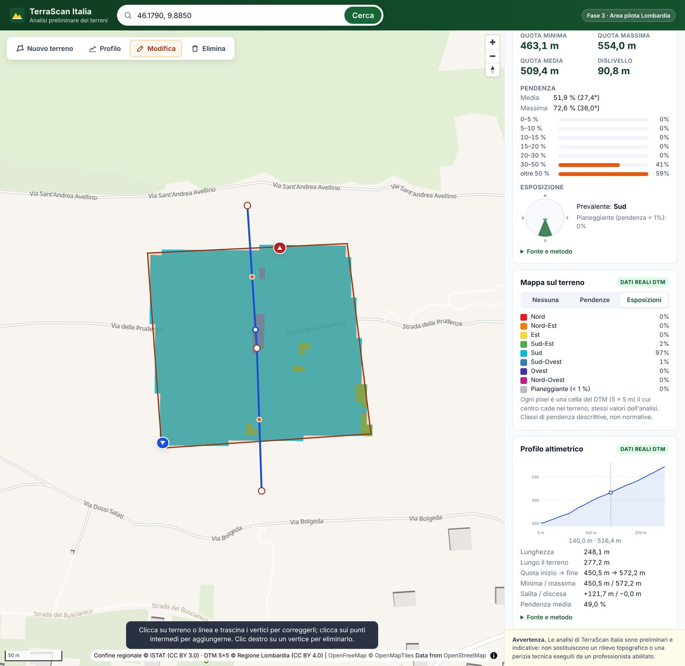
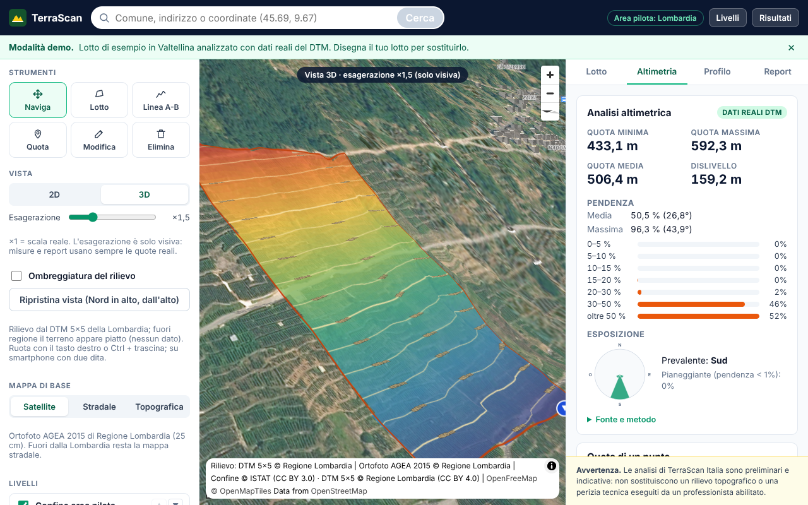
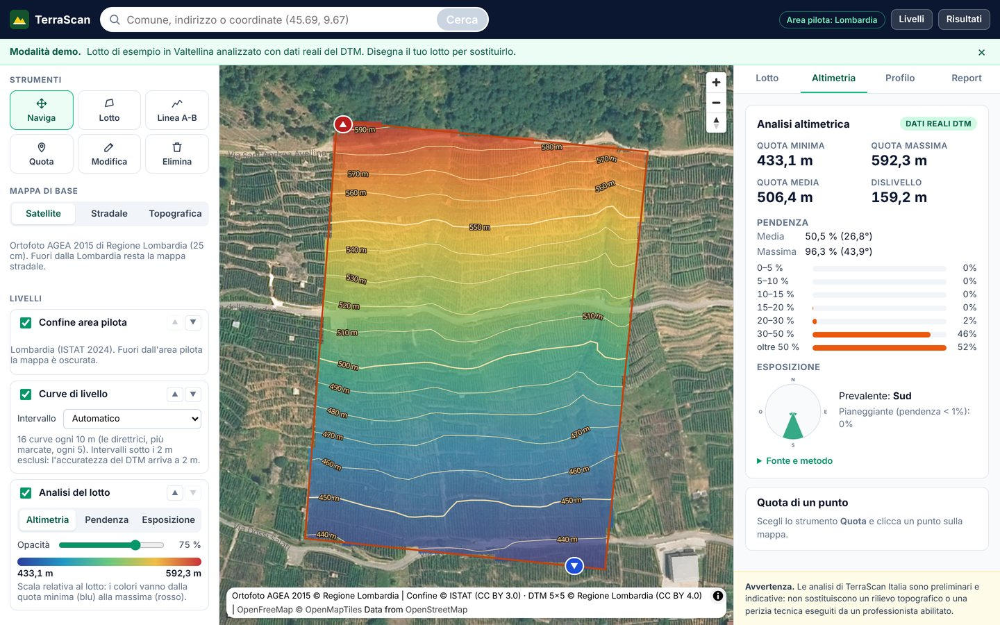

# TerraScan Italia

Piattaforma web per l'analisi preliminare dei terreni, pensata per geometri, ingegneri, agricoltori e imprese edili.

> **Avvertenza.** Le analisi sono preliminari e indicative: non sostituiscono un rilievo topografico o una perizia tecnica eseguiti da un professionista abilitato.



## Novità: piattaforma SaaS (in corso)

- **Landing page** su `/` (dark navy, bianco, smeraldo) con inviti "Analizza un terreno" e "Esplora la demo".
- **Applicazione GIS** su `/app`: mappa a tutto schermo, pannello sinistro (strumenti, mappa di base, livelli con
  interruttore, ordine, opacità e legenda) e destro a schede (Lotto, Altimetria, Profilo, Report); su smartphone i
  pannelli diventano bottom-sheet.
- **Mappe di base**: Satellite (ortofoto AGEA 2015 di Regione Lombardia), Stradale (OpenStreetMap), Topografica
  (CTR/DBT di Regione Lombardia). Verifica delle fonti e licenze da confermare: [piano](docs/piano-piattaforma-saas.md).
- **Elevation Insights** (dati reali DTM 5×5): mappa altimetrica a gradiente ritagliata sul lotto con legenda
  min/max, opacità 0–100%, curve di livello con soli intervalli compatibili con l'accuratezza del dato (≥ 2 m),
  modalità Altimetria / Pendenza / Esposizione, quota di un punto cliccato, pendenze dei tratti del profilo A-B,
  distanza geodetica della linea anche senza DTM.
- **Demo**: `/app?demo` apre un lotto di esempio in Valtellina, dichiarato come tale, analizzato con dati reali.
- **Vista 3D**: rilievo dal DTM 5×5 (tessere Terrarium generate dal server, circa 100 ms a tessera grazie alle
  piramidi del file), rotazione, inclinazione, ripristino della vista, ombreggiatura del rilievo. L'esagerazione
  verticale (×1–×3) è dichiarata come solo visiva: misure e report usano sempre le quote reali. Fuori dalla
  Lombardia il terreno appare piatto (nessun dato) e l'interfaccia lo indica.



Analisi del repository, differenze rispetto ai requisiti e piano delle fasi successive (3D, vincoli territoriali,
report evoluto, funzioni commerciali): [docs/piano-piattaforma-saas.md](docs/piano-piattaforma-saas.md).



## Stato del progetto: Fase 4

| Funzione | Stato |
|---|---|
| Mappa interattiva della Lombardia (area pilota) | ✅ Fase 1 |
| Ricerca di località, indirizzi e coordinate | ✅ Fase 1 (OpenStreetMap / Nominatim) |
| Disegno e modifica del perimetro del terreno | ✅ Fase 1 |
| Calcolo **reale** di superficie e perimetro | ✅ Fase 1, con test |
| Quota minima, massima e media, dislivello, punti più basso e più alto | ✅ Fase 2, DTM 5×5 Regione Lombardia |
| Pendenza media e massima, distribuzione per classi | ✅ Fase 2 |
| Esposizione dei versanti (utile per i terreni agricoli) | ✅ Fase 2 |
| Mappa delle pendenze e mappa delle esposizioni sul terreno (celle 5 × 5 m) | ✅ Fase 3 |
| Profilo altimetrico lungo una linea, con grafico e punto evidenziato sulla mappa | ✅ Fase 3 |
| Report PDF professionale scaricabile dal sito (con campi facoltativi committente/riferimento/note) | ✅ Fase 4 – [esempio](docs/esempio-report.pdf) |
| Login, pagamenti, abbonamenti | ❌ Esclusi per scelta |

L'app non stima né simula valori altimetrici: se il DTM non è installato, se il terreno è fuori dalla Lombardia o
troppo piccolo, nel pannello compare **"Dati altimetrici non disponibili"** con il motivo.

## Come funziona il calcolo

- **Superficie e perimetro** sono calcolati dal backend in modo *geodetico* sull'ellissoide WGS84, con l'algoritmo di Karney (GeographicLib, tramite la libreria `pyproj`). È il metodo di riferimento per misurare poligoni in coordinate geografiche.
- Come **controllo indipendente** viene calcolata anche la superficie in proiezione UTM fuso 32N (EPSG:32632, lo stesso sistema del DTM regionale). La differenza (circa lo 0,1%) è dovuta al fattore di scala della proiezione e viene mostrata nei "Dettagli tecnici".
- La superficie è **planimetrica**: non tiene conto della pendenza.
- La precisione finale dipende da quanto accuratamente si disegna il perimetro sulla mappa.

### Analisi altimetrica (Fase 2)

- Fonte: **DTM 5×5 di Regione Lombardia (ed. 2015)**, licenza CC BY 4.0. Quote in metri sul livello del mare,
  accuratezza dichiarata da 0,30 m (aree urbane) a 2 m (aree agricole e forestali).
- Il poligono viene convertito in UTM 32N (lo stesso sistema del DTM); il DTM non viene mai ricampionato.
- Si usano le celle il cui centro cade dentro il perimetro. Pendenza ed esposizione con il **metodo di Horn**
  (lo stesso di GDAL e QGIS).
- Le classi di pendenza sono descrittive e non normative.
- Il dato installato è stato verificato: tutte le celle sono identiche all'originale, 30 punti su 30 coincidono con
  il servizio WMS ufficiale della Regione e i laghi risultano piatti alla quota nota.
  Dettagli in [docs/dati-dtm-lombardia.md](docs/dati-dtm-lombardia.md).

### Mappe e profilo (Fase 3)

- **Mappe tematiche**: ogni pixel è una cella del DTM (5 × 5 m) il cui centro cade nel terreno, colorata con gli
  stessi valori dell'analisi; le celle sono mostrate nette, senza sfumature.
- **Profilo**: campioni ogni 5 m lungo la linea, quota per interpolazione bilineare tra le 4 celle più vicine,
  distanze geodetiche. I tratti senza dato non vengono disegnati. Salita e discesa cumulate sono indicative.

### Report PDF (Fase 4)

- Pulsante **Scarica report PDF** nel pannello: il sito genera il documento con un clic.
- Il server **ricalcola tutto** con gli stessi moduli dell'app (il browser invia solo il disegno e i campi
  facoltativi): i numeri del PDF coincidono con quelli mostrati a schermo.
- Contenuto: inquadramento (localizzazione in Lombardia e mappa del terreno con scala e Nord), superficie e
  perimetro, analisi altimetrica con mappe di pendenze ed esposizioni, profilo (se tracciato), coordinate dei
  vertici in WGS84 e UTM 32N, fonti, metodi e limiti. L'avvertenza legale è su ogni pagina.
- Le sezioni senza dati riportano "Dati altimetrici non disponibili" con il motivo.

## Struttura delle cartelle

```
terrascan-italia/
├── backend/                 Servizio di analisi (Python + FastAPI)
│   ├── app/
│   │   ├── main.py          Avvio dell'applicazione
│   │   ├── api/             Endpoint HTTP e schemi dei dati
│   │   ├── services/        Calcoli geometrici, altimetria, ricerca località, area pilota
│   │   └── data/            Confine della Lombardia (ISTAT)
│   ├── dati-dtm/            DTM preparato (1,97 GB, NON incluso nel repository)
│   ├── scripts/             Preparazione del DTM e del confine regionale, verifica con il WMS
│   └── tests/               Test automatici (pytest)
├── frontend/                Interfaccia web (React + TypeScript + MapLibre + Terra Draw)
│   └── src/
│       ├── components/      Mappa, barra di ricerca, pannello risultati
│       └── lib/             Client API, formattazione, utilità (con test)
└── docs/                    Documentazione (verifica dati DTM, proposte delle fasi)
```

## Requisiti

Da installare una sola volta sul tuo computer:

1. **Node.js 20 o superiore** – https://nodejs.org (scegli la versione "LTS").
2. **Python 3.11 o superiore** – https://www.python.org/downloads/
3. **uv**, il gestore di pacchetti Python – https://docs.astral.sh/uv/getting-started/installation/
   - Windows (PowerShell): `powershell -ExecutionPolicy ByPass -c "irm https://astral.sh/uv/install.ps1 | iex"`
   - macOS / Linux: `curl -LsSf https://astral.sh/uv/install.sh | sh`

Serve una connessione a Internet: la mappa di base e la ricerca delle località usano servizi online.

## Installare il DTM (una sola volta, per l'analisi altimetrica)

Il DTM non è nel repository perché è molto grande. Lo script lo scarica dal sito della Regione (3,1 GB), lo controlla,
lo converte senza perdita e verifica il risultato. Servono circa 15 GB liberi durante la preparazione; al termine
restano circa 2 GB.

```bash
cd terrascan-italia/backend
uv run python scripts/prepara_dtm.py --pulisci
```

Lo script crea anche le piramidi usate dalla vista 3D. Se il DTM era già installato prima della vista 3D, basta:

```bash
uv run python scripts/aggiungi_piramidi.py     # circa 1-2 minuti; i valori originali non cambiano
```

Facoltativo: verifica a campione del DTM installato con il servizio WMS ufficiale della Regione:

```bash
uv run python scripts/verifica_dtm_wms.py --punti 30
```

Senza DTM l'app funziona lo stesso, ma la sezione altimetrica mostra "Dati altimetrici non disponibili".

## Avvio rapido (un solo comando dopo la preparazione)

Apri un terminale nella cartella `terrascan-italia` ed esegui:

```bash
# 1. Prepara e compila l'interfaccia web (solo la prima volta o dopo modifiche)
cd frontend
npm install
npm run build
cd ..

# 2. Avvia il server (installa da solo le librerie Python la prima volta)
cd backend
uv run uvicorn app.main:app --port 8000
```

Poi apri il browser su **http://localhost:8000** (landing) oppure **http://localhost:8000/app** (applicazione).
Per fermare il server premi `Ctrl + C`.

## Avvio in modalità sviluppo (per modificare il codice)

Servono due terminali aperti contemporaneamente:

```bash
# Terminale 1 – backend con ricaricamento automatico
cd terrascan-italia/backend
uv run uvicorn app.main:app --reload --port 8000

# Terminale 2 – frontend con ricaricamento automatico
cd terrascan-italia/frontend
npm install        # solo la prima volta
npm run dev
```

Apri **http://localhost:5173**. Ogni modifica ai file viene mostrata subito nel browser.

La documentazione interattiva dell'API è disponibile su **http://localhost:8000/docs**.

## Eseguire i test

```bash
cd terrascan-italia/backend
uv run pytest                 # 115 test (12 richiedono il DTM installato, altrimenti vengono saltati)

cd ../frontend
npm test                      # 52 test: formattazione, livelli, pannelli, 3D, grafico, report, landing
npm run typecheck             # controllo dei tipi TypeScript
```

I test dei calcoli confrontano i risultati con riferimenti **indipendenti**:
- superficie e perimetro: formule analitiche dell'ellissoide, un quadrato di un ettaro costruito in coordinate UTM e
  la superficie ufficiale ISTAT della Lombardia;
- altimetria: DTM sintetici con risultato esatto (piani inclinati, terreno piatto, celle mancanti) e, sul DTM reale,
  il valore del WMS regionale e il livello dei laghi di Como, Garda, Lugano e Varese.

## Come si usa

1. **Cerca** un comune, un indirizzo o delle coordinate (es. `45.5135, 9.6105`) e premi *Cerca*.
2. Premi **Disegna terreno** e clicca sulla mappa i vertici del perimetro.
3. **Chiudi** il perimetro cliccando sul primo vertice. Superficie, perimetro, quote, pendenza ed esposizione
   compaiono nel pannello a destra; sulla mappa i simboli ▼ e ▲ indicano il punto più basso e quello più alto.
4. Nel pannello, **Mappa sul terreno** colora il terreno per *Pendenze* o *Esposizioni*, con la legenda.
5. Premi **Profilo**, clicca i punti di una linea e termina cliccando di nuovo sull'ultimo punto (o con *Invio*):
   compare il grafico quota/distanza. Passando sul grafico, il punto corrispondente si illumina sulla mappa.
6. Con **Modifica** puoi trascinare i vertici di terreno e linea, aggiungerne cliccando sui punti intermedi o
   eliminarli con il clic destro: i valori si aggiornano subito.
7. **Elimina** cancella terreno e profilo.
8. **Scarica report PDF** (nel pannello): compila se vuoi committente, riferimento e note, poi *Genera e scarica*.

Su smartphone il pannello dei risultati compare dal basso e si apre o chiude con il pulsante *Mostra/Nascondi risultati*.

## Configurazione (facoltativa)

Variabili d'ambiente del backend:

| Variabile | Predefinito | Uso |
|---|---|---|
| `TERRASCAN_CORS_ORIGINS` | `http://localhost:5173,http://127.0.0.1:5173` | Indirizzi web autorizzati a chiamare l'API |
| `TERRASCAN_NOMINATIM_USER_AGENT` | `TerraScanItalia/0.1 (fase-1 sviluppo)` | Identificativo richiesto dalla policy di Nominatim |
| `TERRASCAN_NOMINATIM_EMAIL` | (vuoto) | Email di contatto, consigliata da Nominatim |
| `TERRASCAN_NOMINATIM_URL` | `https://nominatim.openstreetmap.org/search` | Servizio di geocodifica |
| `TERRASCAN_DTM_PATH` | `backend/dati-dtm/dtm5_lombardia_2015.tif` | Percorso del DTM |

Variabile del frontend (facoltativa, al momento della compilazione):

| Variabile | Uso |
|---|---|
| `VITE_CONTATTO_EMAIL` | Email mostrata nella sezione Contatti della landing; se assente si indica che i contatti sono in attivazione |

**Nota sulla ricerca località.** Il servizio pubblico Nominatim è gratuito ma limitato (massimo 1 richiesta al secondo, nessun uso intensivo). Il backend rispetta il limite e memorizza le ricerche già fatte. Per un uso commerciale servirà un fornitore dedicato o un'istanza propria.

## Fonti dei dati e licenze

| Dato | Fonte | Licenza |
|---|---|---|
| Mappa di base | OpenFreeMap, © OpenMapTiles, dati © OpenStreetMap contributors | Gratuita con attribuzione; dati OSM in licenza ODbL |
| Ricerca località | Nominatim, © OpenStreetMap contributors | ODbL |
| Confine della Lombardia | ISTAT, confini amministrativi al 01/01/2024 (versione generalizzata) | CC BY 3.0 IT |
| DTM 5×5 – Modello digitale del terreno (ed. 2015) | © Regione Lombardia | CC BY 4.0 – vedi [docs/dati-dtm-lombardia.md](docs/dati-dtm-lombardia.md) |

## Documenti

- [Verifica del dataset DTM 5×5 di Regione Lombardia](docs/dati-dtm-lombardia.md)
- [Proposta Fase 2: integrazione dei dati altimetrici](docs/proposta-fase-2.md) (realizzata)
- [Proposta Fase 3: mappa delle pendenze e profilo altimetrico](docs/proposta-fase-3.md) (realizzata)
- [Proposta Fase 4: report PDF](docs/proposta-fase-4.md) (realizzata) – [report di esempio](docs/esempio-report.pdf)
