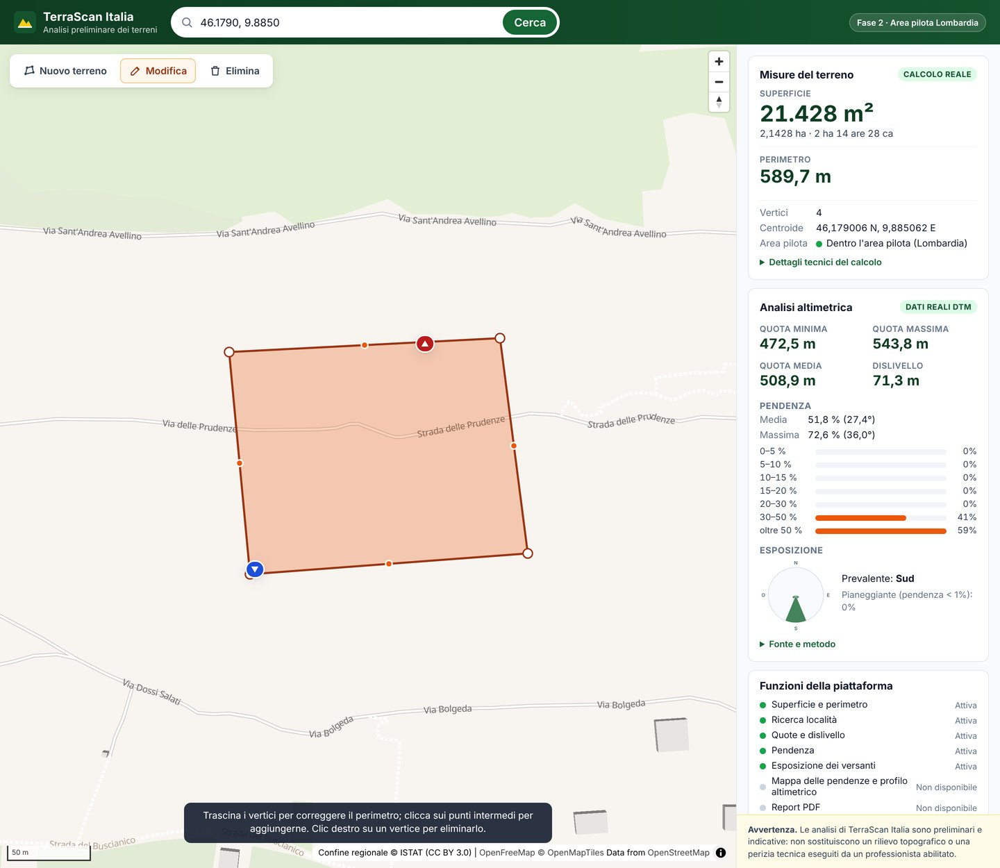

# TerraScan Italia

Piattaforma web per l'analisi preliminare dei terreni, pensata per geometri, ingegneri, agricoltori e imprese edili.

> **Avvertenza.** Le analisi sono preliminari e indicative: non sostituiscono un rilievo topografico o una perizia tecnica eseguiti da un professionista abilitato.



## Stato del progetto: Fase 2

| Funzione | Stato |
|---|---|
| Mappa interattiva della Lombardia (area pilota) | ✅ Fase 1 |
| Ricerca di località, indirizzi e coordinate | ✅ Fase 1 (OpenStreetMap / Nominatim) |
| Disegno e modifica del perimetro del terreno | ✅ Fase 1 |
| Calcolo **reale** di superficie e perimetro | ✅ Fase 1, con test |
| Quota minima, massima e media, dislivello, punti più basso e più alto | ✅ Fase 2, DTM 5×5 Regione Lombardia |
| Pendenza media e massima, distribuzione per classi | ✅ Fase 2 |
| Esposizione dei versanti (utile per i terreni agricoli) | ✅ Fase 2 |
| Mappa delle pendenze, profilo altimetrico | ❌ Fase 3 – vedi [proposta](docs/proposta-fase-3.md) |
| Report PDF | ❌ Fase 4 |
| Login, pagamenti, abbonamenti | ❌ Esclusi per scelta |

L'app non stima né simula valori altimetrici: se il DTM non è installato, se il terreno è fuori dalla Lombardia o
troppo piccolo, nel pannello compare **"Dati altimetrici non disponibili"** con il motivo.

## Come funziona il calcolo

- **Superficie e perimetro** sono calcolati dal backend in modo *geodetico* sull'ellissoide WGS84, con l'algoritmo di Karney (GeographicLib, tramite la libreria `pyproj`). È il metodo di riferimento per misurare poligoni in coordinate geografiche.
- Come **controllo indipendente** viene calcolata anche la superficie in proiezione UTM fuso 32N (EPSG:32632, lo stesso sistema del DTM regionale). La differenza (circa lo 0,1%) è dovuta al fattore di scala della proiezione e viene mostrata nei "Dettagli tecnici".
- La superficie è **planimetrica**: non tiene conto della pendenza.
- La precisione finale dipende da quanto accuratamente si disegna il perimetro sulla mappa.

### Analisi altimetrica (Fase 2)

- Fonte: **DTM 5×5 di Regione Lombardia (ed. 2015)**, licenza CC BY 4.0. Quote in metri sul livello del mare,
  accuratezza dichiarata da 0,30 m (aree urbane) a 2 m (aree agricole e forestali).
- Il poligono viene convertito in UTM 32N (lo stesso sistema del DTM); il DTM non viene mai ricampionato.
- Si usano le celle il cui centro cade dentro il perimetro. Pendenza ed esposizione con il **metodo di Horn**
  (lo stesso di GDAL e QGIS).
- Le classi di pendenza sono descrittive e non normative.
- Il dato installato è stato verificato: tutte le celle sono identiche all'originale, 30 punti su 30 coincidono con
  il servizio WMS ufficiale della Regione e i laghi risultano piatti alla quota nota.
  Dettagli in [docs/dati-dtm-lombardia.md](docs/dati-dtm-lombardia.md).

## Struttura delle cartelle

```
terrascan-italia/
├── backend/                 Servizio di analisi (Python + FastAPI)
│   ├── app/
│   │   ├── main.py          Avvio dell'applicazione
│   │   ├── api/             Endpoint HTTP e schemi dei dati
│   │   ├── services/        Calcoli geometrici, altimetria, ricerca località, area pilota
│   │   └── data/            Confine della Lombardia (ISTAT)
│   ├── dati-dtm/            DTM preparato (1,97 GB, NON incluso nel repository)
│   ├── scripts/             Preparazione del DTM e del confine regionale, verifica con il WMS
│   └── tests/               Test automatici (pytest)
├── frontend/                Interfaccia web (React + TypeScript + MapLibre + Terra Draw)
│   └── src/
│       ├── components/      Mappa, barra di ricerca, pannello risultati
│       └── lib/             Client API, formattazione, utilità (con test)
└── docs/                    Documentazione (verifica dati DTM, proposte delle fasi)
```

## Requisiti

Da installare una sola volta sul tuo computer:

1. **Node.js 20 o superiore** – https://nodejs.org (scegli la versione "LTS").
2. **Python 3.11 o superiore** – https://www.python.org/downloads/
3. **uv**, il gestore di pacchetti Python – https://docs.astral.sh/uv/getting-started/installation/
   - Windows (PowerShell): `powershell -ExecutionPolicy ByPass -c "irm https://astral.sh/uv/install.ps1 | iex"`
   - macOS / Linux: `curl -LsSf https://astral.sh/uv/install.sh | sh`

Serve una connessione a Internet: la mappa di base e la ricerca delle località usano servizi online.

## Installare il DTM (una sola volta, per l'analisi altimetrica)

Il DTM non è nel repository perché è molto grande. Lo script lo scarica dal sito della Regione (3,1 GB), lo controlla,
lo converte senza perdita e verifica il risultato. Servono circa 15 GB liberi durante la preparazione; al termine
restano circa 2 GB.

```bash
cd terrascan-italia/backend
uv run python scripts/prepara_dtm.py --pulisci
```

Facoltativo: verifica a campione del DTM installato con il servizio WMS ufficiale della Regione:

```bash
uv run python scripts/verifica_dtm_wms.py --punti 30
```

Senza DTM l'app funziona lo stesso, ma la sezione altimetrica mostra "Dati altimetrici non disponibili".

## Avvio rapido (un solo comando dopo la preparazione)

Apri un terminale nella cartella `terrascan-italia` ed esegui:

```bash
# 1. Prepara e compila l'interfaccia web (solo la prima volta o dopo modifiche)
cd frontend
npm install
npm run build
cd ..

# 2. Avvia il server (installa da solo le librerie Python la prima volta)
cd backend
uv run uvicorn app.main:app --port 8000
```

Poi apri il browser su **http://localhost:8000**. Per fermare il server premi `Ctrl + C`.

## Avvio in modalità sviluppo (per modificare il codice)

Servono due terminali aperti contemporaneamente:

```bash
# Terminale 1 – backend con ricaricamento automatico
cd terrascan-italia/backend
uv run uvicorn app.main:app --reload --port 8000

# Terminale 2 – frontend con ricaricamento automatico
cd terrascan-italia/frontend
npm install        # solo la prima volta
npm run dev
```

Apri **http://localhost:5173**. Ogni modifica ai file viene mostrata subito nel browser.

La documentazione interattiva dell'API è disponibile su **http://localhost:8000/docs**.

## Eseguire i test

```bash
cd terrascan-italia/backend
uv run pytest                 # 61 test (7 richiedono il DTM installato, altrimenti vengono saltati)

cd ../frontend
npm test                      # 29 test: formattazione, coordinate, client API, pannello
npm run typecheck             # controllo dei tipi TypeScript
```

I test dei calcoli confrontano i risultati con riferimenti **indipendenti**:
- superficie e perimetro: formule analitiche dell'ellissoide, un quadrato di un ettaro costruito in coordinate UTM e
  la superficie ufficiale ISTAT della Lombardia;
- altimetria: DTM sintetici con risultato esatto (piani inclinati, terreno piatto, celle mancanti) e, sul DTM reale,
  il valore del WMS regionale e il livello dei laghi di Como, Garda, Lugano e Varese.

## Come si usa

1. **Cerca** un comune, un indirizzo o delle coordinate (es. `45.5135, 9.6105`) e premi *Cerca*.
2. Premi **Disegna terreno** e clicca sulla mappa i vertici del perimetro.
3. **Chiudi** il perimetro cliccando sul primo vertice. Superficie, perimetro, quote, pendenza ed esposizione
   compaiono nel pannello a destra; sulla mappa i simboli ▼ e ▲ indicano il punto più basso e quello più alto.
4. Con **Modifica** puoi trascinare i vertici, aggiungerne cliccando sui punti intermedi o eliminarli con il clic destro: i valori si aggiornano subito.
5. **Elimina** cancella il terreno disegnato.

Su smartphone il pannello dei risultati compare dal basso e si apre o chiude con il pulsante *Mostra/Nascondi risultati*.

## Configurazione (facoltativa)

Variabili d'ambiente del backend:

| Variabile | Predefinito | Uso |
|---|---|---|
| `TERRASCAN_CORS_ORIGINS` | `http://localhost:5173,http://127.0.0.1:5173` | Indirizzi web autorizzati a chiamare l'API |
| `TERRASCAN_NOMINATIM_USER_AGENT` | `TerraScanItalia/0.1 (fase-1 sviluppo)` | Identificativo richiesto dalla policy di Nominatim |
| `TERRASCAN_NOMINATIM_EMAIL` | (vuoto) | Email di contatto, consigliata da Nominatim |
| `TERRASCAN_NOMINATIM_URL` | `https://nominatim.openstreetmap.org/search` | Servizio di geocodifica |
| `TERRASCAN_DTM_PATH` | `backend/dati-dtm/dtm5_lombardia_2015.tif` | Percorso del DTM |

**Nota sulla ricerca località.** Il servizio pubblico Nominatim è gratuito ma limitato (massimo 1 richiesta al secondo, nessun uso intensivo). Il backend rispetta il limite e memorizza le ricerche già fatte. Per un uso commerciale servirà un fornitore dedicato o un'istanza propria.

## Fonti dei dati e licenze

| Dato | Fonte | Licenza |
|---|---|---|
| Mappa di base | OpenFreeMap, © OpenMapTiles, dati © OpenStreetMap contributors | Gratuita con attribuzione; dati OSM in licenza ODbL |
| Ricerca località | Nominatim, © OpenStreetMap contributors | ODbL |
| Confine della Lombardia | ISTAT, confini amministrativi al 01/01/2024 (versione generalizzata) | CC BY 3.0 IT |
| DTM 5×5 – Modello digitale del terreno (ed. 2015) | © Regione Lombardia | CC BY 4.0 – vedi [docs/dati-dtm-lombardia.md](docs/dati-dtm-lombardia.md) |

## Documenti

- [Verifica del dataset DTM 5×5 di Regione Lombardia](docs/dati-dtm-lombardia.md)
- [Proposta Fase 2: integrazione dei dati altimetrici](docs/proposta-fase-2.md) (realizzata)
- [Proposta Fase 3: mappa delle pendenze e profilo altimetrico](docs/proposta-fase-3.md)
